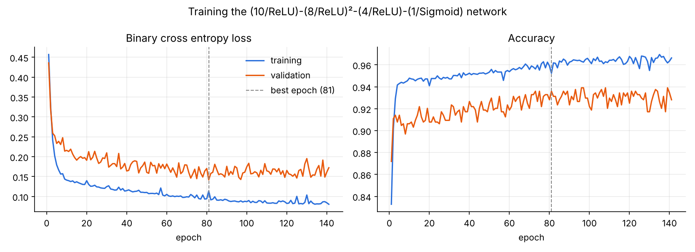
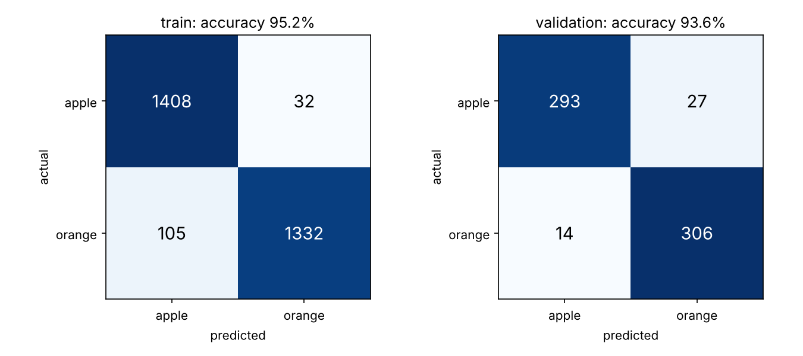

# Apple vs Orange: Multilayer Neural Network

Artificial Neural Networks, Labs 1 and 2. I built a deep neural network from scratch in NumPy that classifies images of fruit as apple (0) or orange (1).

## Network

`(10/ReLU) – (8/ReLU)² – (4/ReLU) – (1/Sigmoid)`, 261 trainable parameters.

| Layer | Neurons | Activation |
|---|---|---|
| 1 | 10 | ReLU |
| 2 | 8 | ReLU |
| 3 | 8 | ReLU |
| 4 | 4 | ReLU |
| 5 | 1 | Sigmoid (output y(p) = probability of orange) |

## Lab 1: network and training set

* `lab1/network.py` is where I define the network: the forward pass, the binary cross entropy loss, and backpropagation.
* `lab1/build_dataset.py` is how I build the training set from images. I describe each image with five features measured on the fruit pixels:

| Feature | Meaning |
|---|---|
| hue | average colour angle in degrees (red about 0, orange about 30, yellow about 55, green 60 to 90) |
| saturation | colour intensity, 0 to 255 |
| brightness | lightness, 0 to 255 |
| roundness | 4π·area / perimeter² of the outline (1.0 is a perfect circle) |
| texture | variance of the Laplacian inside the fruit (rougher skin scores higher) |

**Objects.** I use whole fruit only. I include eight apple varieties (red, green, yellow, and mixed) so that colour alone cannot separate the two classes. The images come from the [Fruits 360](https://github.com/fruits-360/fruits-360-100x100) dataset (CC BY-SA 4.0). I also measured a small set of stock photos, which I use only for testing.

**Augmentation.** Besides each original training image, I add randomly altered copies (brightness, contrast, sharpness, saturation, a small hue shift, and a slight stretch). This widens each class so the classes overlap, which forces the network to learn more than one simple rule.

| File | Rows | Use |
|---|---|---|
| `lab1/data/train.csv` | 2,877 (1,440 apples, 1,437 oranges) | training |
| `lab1/data/validation.csv` | 640 (320 / 320) | validation, from separate source images |
| `lab1/data/realworld_test.csv` | 6 (4 apples, 2 oranges) | stock photos, never used in training |

## Lab 2: training

`lab2/train.py` is where I train the network with mini batch gradient descent and backpropagation.

* I standardise the inputs using training set statistics only
* Learning rate 0.05, batch size 32, up to 400 epochs
* I stop early after 60 epochs without validation improvement and keep the best weights
* Before training, I verify backpropagation against numerical gradients (worst relative error 5.2e-9)

### Results

| Set | Accuracy | Loss |
|---|---|---|
| Training | 95.2% | 0.114 |
| Validation | 93.6% | 0.142 |
| Stock photos | 4 of 6 | 0.395 |





**What I observed**

* Training and validation loss fall quickly over the first 20 epochs and then level off. The best validation loss came at epoch 81, and training stopped at epoch 141.
* Most validation errors come from apples with orange tones: Pink Lady (65% correct) and Red Yellow (77.5% correct). These varieties overlap with oranges in hue, so I expected these errors.
* All four stock photo apples are classified correctly, but both stock photo oranges are called apples (y(p) of 0.27 and 0.35). The stock photos are brighter than anything in my orange training data, which comes from a single orange in Fruits 360. This is domain shift: having seen only one orange, the network does not generalise to new ones. Adding orange photos from varied sources would be the most effective improvement.

The full output is in `lab2/results/`: `training_log.txt`, `metrics.json`, `training_history.csv`, `realworld_predictions.csv`, and `trained_weights.npz`.

## Running

```bash
pip install numpy pandas matplotlib opencv-python
python lab1/network.py          # print the architecture
python lab2/train.py            # train and write results
```

To rebuild the dataset, you need the Fruits 360 images:

```bash
python lab1/build_dataset.py <path to fruits-360-100x100> <folder of test photos> lab1/data
```
